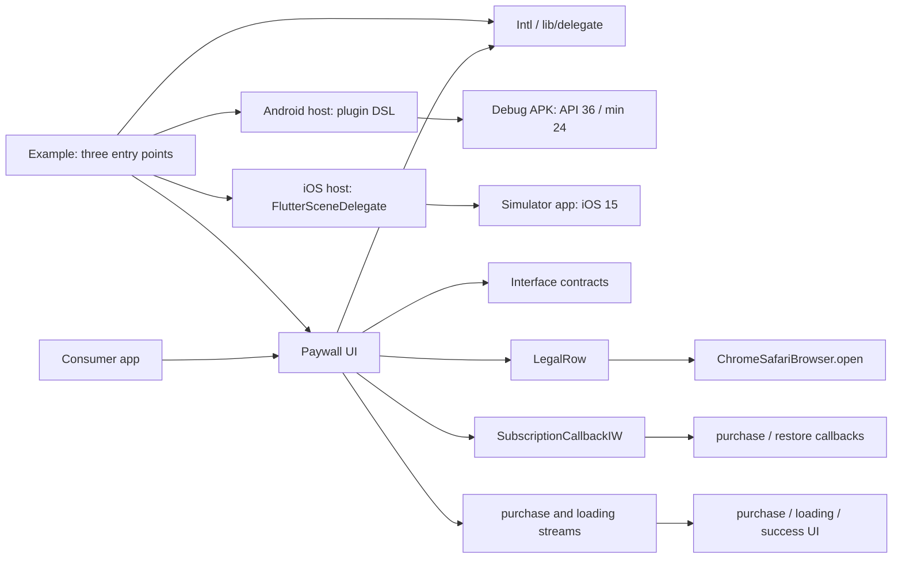

# Paywall Package Architecture

## Scope

This repository contains three independently resolved Flutter packages and one
standalone mobile example. It is not a Pub workspace: run dependency,
analysis, generation, test, and build commands from the directory that owns
the relevant `pubspec.yaml`.

| Package | Responsibility | Public entry point |
| --- | --- | --- |
| `in_app_purchases_interface` | Purchase callbacks, subscription data, and purchase-state contracts | `lib/in_app_purchases_interface.dart` |
| `in_app_purchases_intl` | Generated paywall localizations plus duration and fallback helpers | `lib/in_app_purchases_intl.dart` |
| `in_app_purchases_paywall_ui` | Paywall widgets, purchase-state rendering, callback forwarding, and legal-link dispatch | `lib/in_app_purchases_paywall_ui.dart` |
| `example` | Android/iOS demo hosts plus simple and localized paywall flows | `lib/main.dart`, `lib/main_intl.dart`, `lib/main_moritz_intl.dart` |

## Dependencies And Control Flow

The UI package consumes both sibling packages through Git dependencies on the
`upgrade/flutter-3.44.9` branch. During pre-push development only, a local
`pubspec_overrides.yaml` may point to the sibling directories; it must not be
committed or used as final Git-consumer evidence.

The standalone Example is different by design: its own manifest permanently
uses repository-relative paths for UI and Intl and overrides all three sibling
packages. This keeps demo compilation tied to the checkout being developed,
without changing the public package manifests or the consuming App's Git refs.

## Native Example Hosts

- Android uses the declarative Flutter plugin DSL with AGP 8.10.1, Gradle
  8.11.1, Kotlin 2.1.21, Java/Kotlin 17, compile/target SDK 36, and Flutter's
  min SDK 24. Namespace and application ID remain `io.linkfive.example`.
- iOS remains a CocoaPods project at deployment target 15. `AppDelegate`
  registers plugins through `FlutterImplicitEngineDelegate`; `Info.plist`
  declares exactly one `FlutterSceneDelegate` application scene using the
  existing `Main` storyboard.
- `flutter.config.enable-swift-package-manager: false` is local to the Example;
  it does not change the global Flutter installation.

## Localization

`packages/in_app_purchases_intl/l10n.yaml` makes `lib/delegate` the direct
`gen-l10n` output. The generated `PaywallLocalizations` API and its German,
English, and Spanish implementations are committed and exported through the
package barrel. `PaywallL10NHelper.of` deliberately falls back to English when
no localization delegate exists in the widget tree.

## Invariants

- Public imports under `lib/delegate` and the existing paywall paths remain
  stable for consumers.
- `SubscriptionCallbackIW` forwards the selected `SubscriptionData` once and
  delegates restore once.
- Loading is an overlay state; a purchase-state transition underneath it must
  still become visible when loading ends.
- `LegalRow` preserves optional TOS/privacy visibility and dispatches the
  configured URL with the existing Chrome Custom Tabs/Safari settings.
- Paywall bullet text and Moritz price labels stay horizontally bounded, while
  legal links wrap on compact viewports; these rows may not overflow a
  phone-sized layout.
- Interface and Intl locks are versioned. The UI lock is deliberately ignored
  and is generated locally for reproducible review commands.
- Example resolution must keep all three sibling `rootUri` values inside this
  checkout. A hosted or Git-cache sibling is not an equivalent demo input.
- UI cleanup tests use canonical local Interface/Intl roots while developing;
  after publication, Git-cache roots are accepted only when repository path,
  origin, clean worktree, and package-tree identity match this checkout.
- Native build evidence must be produced from the Example working directory
  with the App-bound Flutter 3.44.9 executable, never with a global SDK or the
  consuming App's host project.

## Validation

Use Flutter 3.44.9 for every package. Resolve each package separately, run
`gen-l10n` from the Intl package, then run package tests and analysis with
`--no-pub` where reproducibility matters. Example fast tests cover all three
entry points, localization, simulated purchase/restore, local package roots,
and native configuration pins. `MMB0014_source_cleanup_regression` reuses the
established behavior cases and proves that UI tests exercise the cleaned
sibling package trees. The separate native test builds and inspects a real
debug APK and iOS Simulator app. After the upgrade branch is pushed, the final
UI resolution and a separate consumer must use Git sources without path
overrides.
