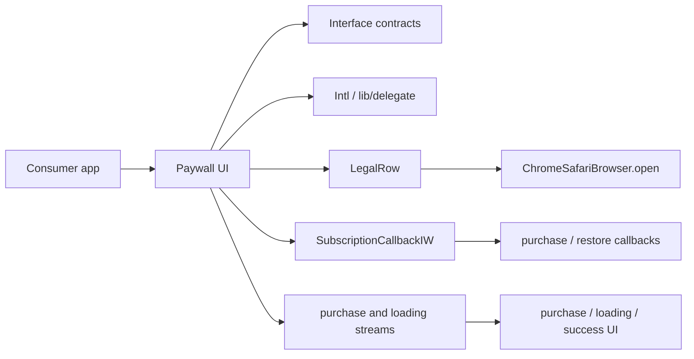

# Paywall Package Architecture

## Scope

This repository contains three independently resolved Flutter packages. It is
not a Pub workspace: run dependency, analysis, generation, and test commands
from the package that owns the relevant `pubspec.yaml`.

| Package | Responsibility | Public entry point |
| --- | --- | --- |
| `in_app_purchases_interface` | Purchase callbacks, subscription data, and purchase-state contracts | `lib/in_app_purchases_interface.dart` |
| `in_app_purchases_intl` | Generated paywall localizations plus duration and fallback helpers | `lib/in_app_purchases_intl.dart` |
| `in_app_purchases_paywall_ui` | Paywall widgets, purchase-state rendering, callback forwarding, and legal-link dispatch | `lib/in_app_purchases_paywall_ui.dart` |

## Dependencies And Control Flow

The UI package consumes both sibling packages through Git dependencies on the
`upgrade/flutter-3.44.9` branch. During pre-push development only, a local
`pubspec_overrides.yaml` may point to the sibling directories; it must not be
committed or used as final Git-consumer evidence.

## Localization

`packages/in_app_purchases_intl/l10n.yaml` makes `lib/delegate` the direct
`gen-l10n` output. The generated `PaywallLocalizations` API and its German,
English, and Spanish implementations are committed and exported through the
package barrel. `PaywallL10NHelper.of` deliberately falls back to English when
no localization delegate exists in the widget tree.

## Invariants

- Public imports under `lib/delegate` and the existing paywall paths remain
  stable for consumers.
- `SubscriptionCallbackIW` forwards the selected `SubscriptionData` once and
  delegates restore once.
- Loading is an overlay state; a purchase-state transition underneath it must
  still become visible when loading ends.
- `LegalRow` preserves optional TOS/privacy visibility and dispatches the
  configured URL with the existing Chrome Custom Tabs/Safari settings.
- Interface and Intl locks are versioned. The UI lock is deliberately ignored
  and is generated locally for reproducible review commands.

## Validation

Use Flutter 3.44.9 for every package. Resolve each package separately, run
`gen-l10n` from the Intl package, then run package tests and analysis with
`--no-pub` where reproducibility matters. After the upgrade branch is pushed,
the final UI resolution and a separate consumer must use Git sources without
path overrides.
